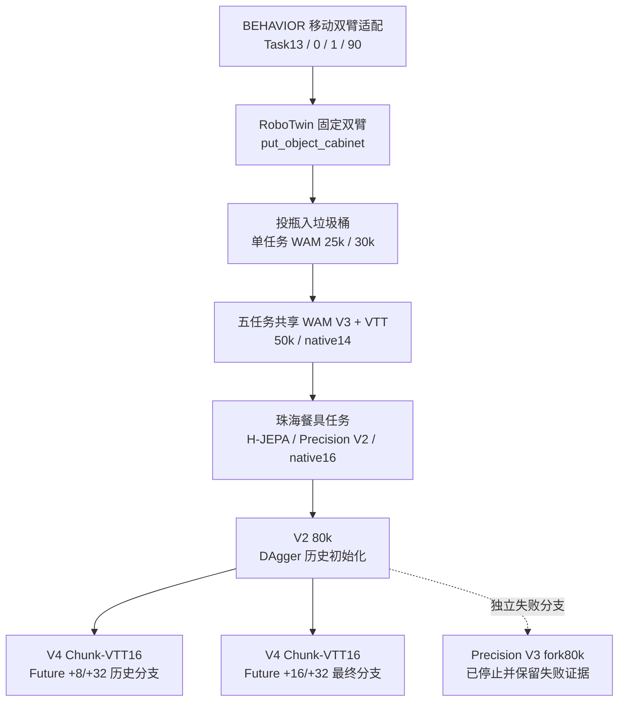

# WAM 版本演进与任务转换

本索引按 2026-10-14 尚存的源码、训练契约、权重和实验记录整理。它描述研发轨迹，不假设每次修改都会提升成绩。目录中的历史计划和授权是实验资料，不是启动训练或恢复失败分支的指令。

## 两条轴：模型改动和任务转换



箭头表示迁移/研发关系，不能仅凭箭头认定每一条都是严格加载同一模型权重。具体初始化以各 run manifest 与 checkpoint SHA 为准。最终 Future16 从原 V2 80k 重新初始化，不是接着旧 V4 +8/+32 中断分支训练。

**命名需要区分：** 早期移动任务的 WAM V3、RoboTwin 五任务的 WAM V3 和后来的 Precision V3 不是同一训练版本。旧 BEHAVIOR Task1/Task2 编号也不等于珠海比赛任务编号。

## 阶段、修改与已验证结果

| 阶段 | 任务/机器人与主要修改 | 已知结果 | 可比性与复现边界 |
|---|---|---|---|
| 2026-09，最早保留的适配记录 | BEHAVIOR Task13 装车；合同条件、动作语义、相机域、delta/位置、本体历史、多视角等逐步适配 | 历史索引 21 份闭环评分均失败/Q0 | 是混合设置的记录数，不是同协议 0/21；部分旧权重已经历史清理 |
| 2026-09，Task0/Task1 | 移动双臂收音机/捡垃圾；独立任务训练与 V2/V3 适配 | Task0 历史 6 份、Task1 3 份评分均失败/Q0 | 示教动作回放得到 Q1 不算策略成功；细节见原始索引 |
| 2026-09-30–10-04，Task90 | R1Pro 厨余入桶；50k；61D 本体输入、23D 动作、chunk32/exec8 | 最终三测完整任务 0/3，收尾/评分异常单列；保留最终 50k 模型 | 辅助抓取、底盘预定位与非官方移植协议均需披露；旧检查点删除后不可直接重现全部阶段 |
| 2026-10-04–07，柜体任务 | 迁移 RoboTwin 固定双臂、native14；TRAIN400/VAL50/heldout50；30k；事务执行与中下层子系统 | 30k 开发三测 1/3；透明事务路径 10 个有效回合 1/10，另有初始化无效 | 早期 15k/25k 各 0/3；部分中断不可补成策略失败；不证明完整高层系统能力 |
| 2026-10-07，投瓶单任务 | 官方 clean50、40/5/5；native14；纯 WAM 条件为零；25k/30k | 同开发五种子：25k 4/5、30k 3/5；25k 另一个固定20种子协议 7/20 | 五测与20测不合并择优；原生成功为瓶原点范围谓词，不等于严格容纳/释放 |
| 2026-10-07，投瓶加中下层 | 同25k和五种子；反馈、事务执行、停滞监测与回合内记忆接线 | 仍4/5，五条动作与纯WAM逐位一致，未触发干预 | 未证明中下层收益；VLM/ASK/完整后条件未开启 |
| 2026-10-08，五任务共享 | 投瓶、易拉罐入盒、开笔记本、按铃、按订书机；TRAIN-only VTT；共享50k；native14 | 每任务10次：4/10、1/10、9/10、10/10、10/10，总34/50 | 任务成功谓词不同；无匹配消融；从投瓶单任务初始化的优势需披露 |
| 2026-10-09–11，珠海餐具 | native16 实测状态、因果历史/时钟、Future辅助监督、IDM、近端精细视觉、DAgger与数据覆盖诊断 | 各预算与变体结果由 run 原始记录索引保留；V2 80k 的最终同五场景基线0/5 | 原80k历史使用DAgger；新一轮排除纠正数据不代表整个模型历史无DAgger |
| 2026-10-12，Precision V3失败支线 | 从80k派生的完整32步精修等实验支线 | 未完整完成；历史失败证据保留，四个检查点已按先前授权清理 | 不得冒称有训练完成的V3对照；不得自动重启 |
| 2026-10-12，V4原Future分支 | Chunk-VTT16预测、projection/alpha分阶段解冻；旧+8/+32辅助监督 | 短跑2250步有VAL诊断下降，但不是物理成功率 | 重启、中断、错误exec16分支均保留身份；不拼成最终完成训练 |
| 2026-10-13，V4 Future16最终分支 | 从V2 80k重启；监督+16/+32，Chunk-VTT16、exec8；新增50k到130k；160原版TRAIN | 127500 0/5，130000 0/5，最终平均任务进度下降 | 不宣称V4提升成功率；前5000步B4后B23，更新预算相同不代表样本预算相同 |

## 代码、数据与结果如何对应

1. 当前 `harness/`、`scripts/`、`configs/` 包含历史兼容模块和最新实现。完整保留的历史源码快照在 Release 的 `historical-sources` 中，沿原路径恢复；它们优先于用当前文件猜测过去实现。
2. [`evidence-index.json`](evidence-index.json) 记录精选原报告的原路径、发布路径、长度和 SHA256。`evidence/` 内文件是原文副本，未将旧路径或历史结论改写成新结果。原文相对链接可能只在恢复完整 Release 后有效。
3. [`retained-checkpoints.json`](retained-checkpoints.json) 列出所有现存模型及全状态/fixture类别。Release 清单记录逐文件 SHA256，不能把 smoke 或合成测试模型当作正式策略。
4. 自采示教 HDF5、split/manifest、动作/评分/规则、机载观测与既有录像分别保留。未新录制或重渲染任何视频。
5. 上游 BEHAVIOR / RoboTwin 数据、仿真资产和通用编码器仍按原来源下载；`data-provenance/` 保存现存来源和划分记录，不把上游内容重新标为自有数据。

## 大文件下载与恢复

[历史数据与权重 Release](https://github.com/susongyuan/Predict-WAM-V4/releases/tag/wam-history-artifacts-20261014) 在全部文件上传、远端长度与 SHA256 核验完成前保持 draft。上传中不能将某个类别已完成解释成全部已上传。

各类别是一条 tar 流，分成最多 1.5GiB 的 part；必须下载该类别的全部 part 和对应 manifest。**先验证每个 part 的 SHA256，随后按编号拼接再解包到独立目录**：

```bash
python tools/restore_wam_release.py --assets /path/to/downloads --category priority-weights --out /path/to/restored
```

类别含：关键路径模型、元数据、示教数据、其余检查点、观测与结果、历史源码。完整 `plan.json` 记录纳入和排除范围。解包恢复原相对路径；文件名、hardlink/原SHA和训练契约应保持，不要盲目全局替换历史绝对路径。

## 明确缺口

- 2026-10-04 已按当时授权删除137条旧检查点项，仅保留旧移动任务最终50k；本次不能恢复那些已删除权重。
- 失败 Precision V3 的四个权重及错误 exec16 队列历史已清理，本次保留可用失败证据，不补造权重或物理结果。
- 早期 checkpoint 不齐时，只能声称有源码/报告/谱系记录，不能声称每个阶段都能重跑。
- 报告中的Q、原生谓词、严格比赛成功和辅助事件是不同指标；不得合并成同一成功率曲线。
- 当前尚未在干净机器上复现全流程，完整系统高层能力与实机部署收益尚未证明。
